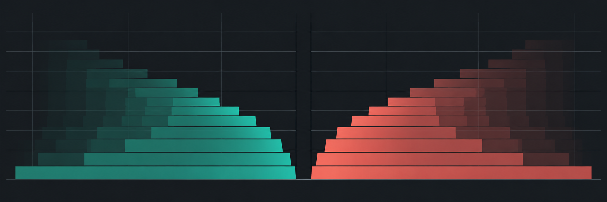
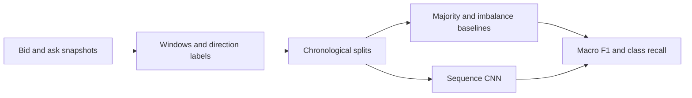

# Limit Order Book Modelling



**Do recent order book snapshots contain enough signal to predict short-horizon mid-price direction?** This project will compare simple volume-based baselines with a convolutional neural network on chronological market data.

**Python 3.10+** · **Synthetic demo available** · **Forecasting benchmark planned**

[Quick start](#quick-start) · [Experiment design](#experiment-design) · [Repository guide](#repository-guide)

## Quick start

From the repository root, run the standard-library demo.

```sh
python src/baseline.py
```

```text
Synthetic imbalance: 0.333
```

The demo sums two levels on each side of a synthetic order book. Bid volume is 20 and ask volume is 10, so the imbalance is `(20 − 10) / (20 + 10)`. A positive value means there is more volume on the bid side of this snapshot.

## Experiment design

The planned pipeline labels each window by future mid-price direction. Training and evaluation are split by time, with a gap where label windows could overlap.



| Question | How to check |
| --- | --- |
| Does book imbalance add signal? | Compare an imbalance model with a majority-class predictor. |
| Does the CNN help? | Score both on the same held-out windows and report recall for up, flat and down moves. |
| Does a simulated strategy survive costs? | Report trading costs and assumptions separately from forecasting metrics. |

The first milestone is a licensed, timestamped dataset and a repeatable comparison of the two simple baselines.

## Repository guide

- [Volume imbalance](src/baseline.py) — single-snapshot calculation and synthetic demo.
- [First benchmark](experiments/README.md) — data requirements, splits and metrics.
